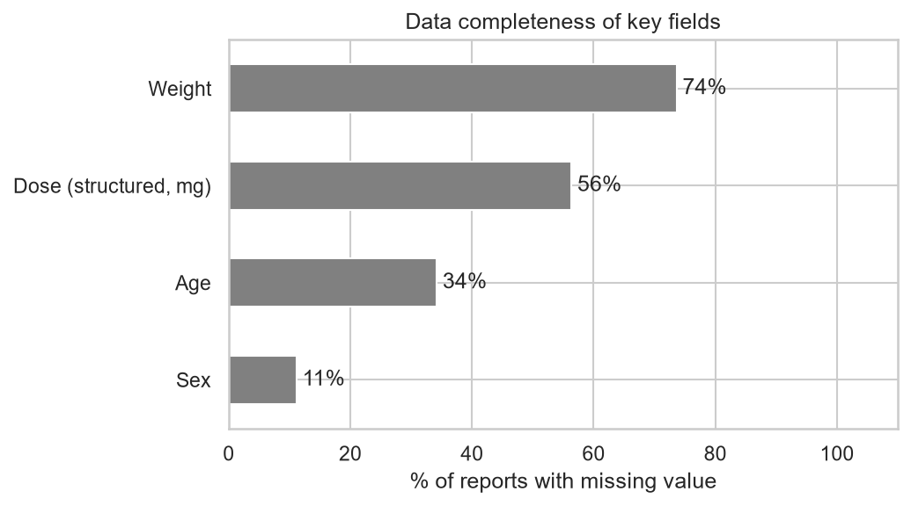
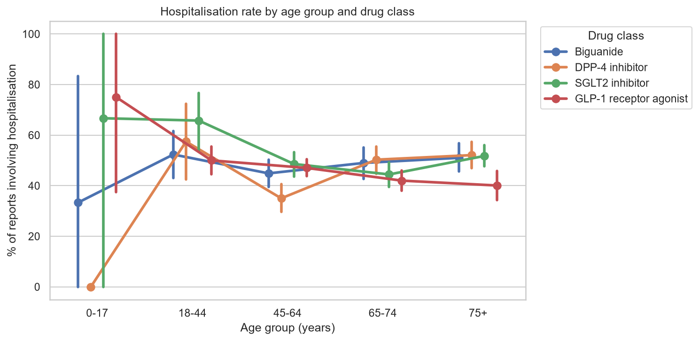
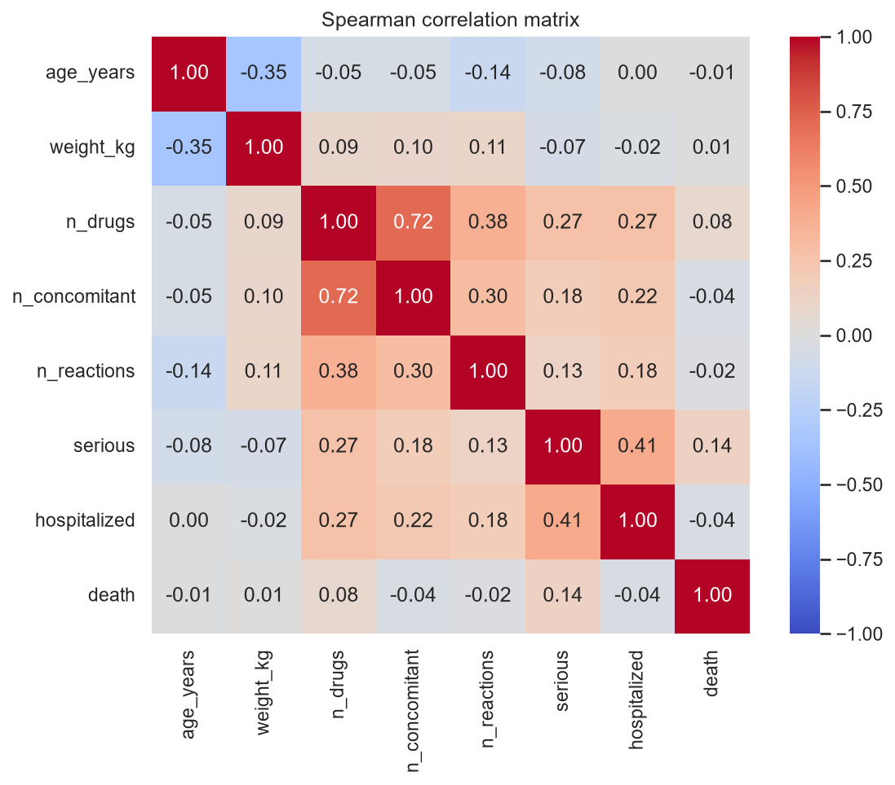
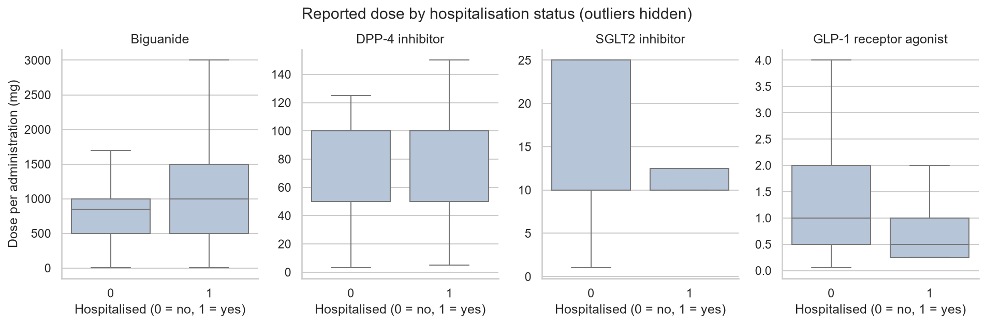
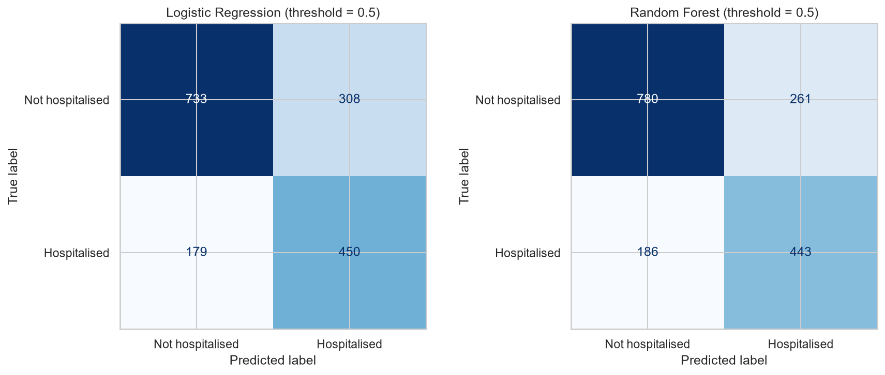

# Adverse Event Reporting for Type 2 Diabetes Medications
### An analysis of FDA Adverse Event Reporting System (FAERS) data via the openFDA API


---

## Key Findings

- **Each drug class has a distinct reporting profile** consistent with its known pharmacology:
  gastrointestinal reactions for semaglutide (GLP-1), lactic acidosis and acute kidney injury
  for metformin, and adherence-related reports for sitagliptin (DPP-4).
- **Polypharmacy is strongly associated with hospitalisation:** the hospitalisation rate roughly
  doubles from about 31% in reports with no concomitant drugs to about 65% in reports with 10 or more.
- **Age shapes the reaction profile:** gastrointestinal and off-label reports peak in adults aged
  18–44, while lactic acidosis and acute kidney injury increase steadily with age.
- **A Random Forest model predicts hospitalisation** with a test ROC-AUC of **0.82** and a PR-AUC of
  **0.75**, roughly double the random baseline of 0.38, with clinically plausible predictors.

---

## 1. Introduction

The FDA Adverse Event Reporting System (FAERS) collects reports of suspected adverse
drug reactions submitted by healthcare professionals, consumers and manufacturers.
It is one of the main data sources used in **pharmacovigilance**, the science of
monitoring the safety of medicines after they reach the market.

This project builds an end-to-end data pipeline that:

1. **extracts** adverse event reports from the public openFDA API,
2. **cleans and transforms** deeply nested JSON into analysis-ready tables,
3. **explores** reporting patterns through visualisations, and
4. **trains machine learning models** to predict whether a reported event involved
   hospitalisation.

The analysis focuses on four widely prescribed type 2 diabetes medications, each
representing a different drug class:

| Drug | Drug class | Example brand names |
|---|---|---|
| Metformin | Biguanide | Glucophage |
| Sitagliptin | DPP-4 inhibitor | Januvia |
| Empagliflozin | SGLT2 inhibitor | Jardiance |
| Semaglutide | GLP-1 receptor agonist | Ozempic, Rybelsus, Wegovy |

## 2. Motivation

Working as a pharmacy technician, I see every day how many patients manage type 2
diabetes with several medications at once, and how important it is to understand
their side effects. This project combines that practical perspective with my
background in statistics to explore what real-world safety reports can, and cannot,
tell us about these medicines.

## 3. Research Questions

| # | Question |
|---|---|
| **RQ1** | Which adverse reactions are most frequently reported for each drug class, and how do they differ across age groups? |
| **RQ2** | How do serious outcomes (hospitalisation, death) vary across drug classes and age groups? |
| **RQ3** | Is the number of concomitant medications (polypharmacy) or the reported dose associated with the severity of reported events? |
| **RQ4** | Can a simple machine learning model predict whether a reported adverse event involved hospitalisation, based on patient characteristics, co-medication and reported reactions? |

## 4. Data

**Source:** [openFDA Drug Adverse Event API](https://open.fda.gov/apis/drug/event/), a public,
harmonised version of FAERS.

**Extraction criteria:**
- Reports received by the FDA between **1 January 2020 and 31 December 2024**
- The **5,000 most recent reports per drug**
- Only reports where the study drug is listed as a **suspect** drug (not merely concomitant)
- Reports where more than one study drug is suspect are excluded, to keep drug classes comparable

**Key fields used:**

| Field | Description |
|---|---|
| `serious`, `seriousnesshospitalization`, `seriousnessdeath` | Outcome flags |
| `patient.patientonsetage` + unit | Age at onset (converted to years) |
| `patient.patientsex`, `patient.patientweight` | Demographics |
| `patient.drug[].drugcharacterization` | Suspect / concomitant / interacting drug |
| `patient.drug[].drugstructuredosagenumb` + unit | Structured dose (used when reported in mg) |
| `patient.reaction[].reactionmeddrapt` | Reported reactions (MedDRA Preferred Terms) |
| `primarysource.qualification` | Reporter type (healthcare professional vs consumer) |

**Cleaning log:**

| Step | Reports |
|---|---|
| Downloaded (5,000 most recent per drug) | 20,000 |
| After removing duplicates | 20,000 |
| Study drug listed as suspect | 8,976 |
| Only one study drug suspect (final dataset) | **8,348** |

**Final dataset:** 8,348 reports and 33,061 report-reaction pairs.

| Drug | Matching reports in FAERS (2020–2024) | Reports in final dataset |
|---|---|---|
| Metformin | 138,742 | 1,365 |
| Sitagliptin | 24,069 | 1,499 |
| Empagliflozin | 40,826 | 2,106 |
| Semaglutide | 38,208 | 3,378 |

Only 27% of downloaded metformin reports listed it as a suspect drug, compared with 68%
for semaglutide. This reflects metformin's role as first-line background therapy: it is
frequently recorded as a concomitant medication in reports concerning other drugs.

## 5. Methodology

```
openFDA API ──► fetch_data.py ──► clean_data.py ──► eda.py ──► model.py
  (JSON)          raw JSON        flat CSV tables    figures    metrics + figures
```

**Data cleaning and transformation (`clean_data.py`)**
- Flattened nested JSON (patients → drugs → reactions) into a report-level and a reaction-level table
- Converted age from mixed units (decades, years, months, days...) to years and removed implausible values
- Decoded coded fields (sex, reporter type, drug role) into readable categories
- Engineered features: number of concomitant drugs, number of reactions, age groups, polypharmacy groups
- Removed duplicate reports and logged the number of records at each cleaning step

**Exploratory analysis (`eda.py`)**
- Data completeness check for key fields
- Outcome rates by drug class
- Most frequent reactions by age group and by drug class (normalised heatmaps)
- Hospitalisation rates by polypharmacy level, age group and dose, with 95% confidence intervals
- Spearman correlation matrix

**Machine learning (`model.py`)**
- **Target:** whether the report indicates hospitalisation (binary)
- **Features:** age, weight, sex, reporter type, drug class, number of concomitant drugs,
  number of reactions, report year, US vs non-US, and the 30 most frequent reactions (multi-hot encoded)
- **Models:** Logistic Regression (interpretable baseline) and Random Forest
- **Validation:** stratified 80/20 train-test split and 5-fold cross-validation
- **Class imbalance:** handled with balanced class weights
- **Missing values:** median imputation with missing-value indicators
- **Data leakage prevention:** other seriousness flags (e.g. death) and outcome-describing
  reaction terms (e.g. *Hospitalisation*) are excluded; reaction features are selected
  using the training set only
- **Evaluation:** ROC-AUC, PR-AUC (compared against the prevalence baseline), precision, recall, F1
- **Interpretation:** logistic regression coefficients and Random Forest permutation importance

## 6. Technologies Used

| Category | Tools |
|---|---|
| Language | Python 3.10+ |
| Data extraction | `requests`, openFDA REST API |
| Data wrangling | `pandas`, `numpy` |
| Visualisation | `matplotlib`, `seaborn` |
| Machine learning | `scikit-learn` (pipelines, imputation, encoding, cross-validation) |
| Development | PyCharm, Git, GitHub |

## 7. Project Structure

```
faers-diabetes-adverse-events/
├── README.md
├── requirements.txt
├── src/
│   ├── config.py          # shared settings
│   ├── fetch_data.py      # 1. data extraction (openFDA API)
│   ├── clean_data.py      # 2. cleaning and transformation
│   ├── eda.py             # 3. exploratory analysis and figures
│   └── model.py           # 4. machine learning
├── data/                  # raw and processed data (not tracked in Git)
├── figures/               # generated charts
└── results/               # metrics and summary tables
```

## 8. How to Run

```bash
# 1. Clone the repository and install dependencies
git clone https://github.com/<your-username>/faers-diabetes-adverse-events.git
cd faers-diabetes-adverse-events
pip install -r requirements.txt

# 2. (Optional) set a free openFDA API key for higher rate limits
#    macOS / Linux:
export OPENFDA_API_KEY="your_key"
#    Windows (PowerShell):
$env:OPENFDA_API_KEY="your_key"

# 3. Run the pipeline
python src/fetch_data.py
python src/clean_data.py
python src/eda.py
python src/model.py
```

## 9. Results

### 9.1 Data quality



Data completeness varies considerably across fields. Weight was missing in **74%** of reports,
structured dose in **56%**, age in **34%** and sex in **11%**. Structured dose coverage ranged from
33% (biguanide) to 52% (GLP-1 receptor agonist), which limits the dose analysis in RQ3.

Missingness does not appear to be random. Hospitalisation rates among reports with a recorded
age (roughly 40–55% across adult age groups) are higher than the overall rate of 37.7%,
suggesting that reports without an age, often less complete consumer reports, tend to describe
less severe events. This is also reflected in the model, where age and weight rank among the
most important features (section 9.5).

### 9.2 Reported reactions (RQ1)


Each drug class shows a distinct reporting profile, consistent with its known pharmacology:

- **GLP-1 receptor agonist (semaglutide):** gastrointestinal reactions dominate, including
  nausea (19.3% of reports), vomiting (15.3%), diarrhoea (12.6%), impaired gastric emptying
  (11.5%) and constipation (11.3%). The high frequency of *off label use* (11.5%) and
  *product use in unapproved indication* (7.1%) likely reflects use for weight management.
- **Biguanide (metformin):** lactic acidosis (23.7%) and acute kidney injury (14.7%), the
  best-known serious safety concerns for metformin, particularly in patients with
  impaired renal function.
- **DPP-4 inhibitor (sitagliptin):** *product dose omission issue* (16.7%) and *blood glucose
  increased* (9.3%) are the most distinctive terms, pointing to adherence and lack-of-efficacy
  reports rather than drug toxicity.
- **SGLT2 inhibitor (empagliflozin):** shows low percentages across the heatmap because the
  top 15 terms were selected across all classes and are dominated by the largest class
  (GLP-1, 40% of reports). SGLT2-specific signals such as *euglycaemic diabetic ketoacidosis*
  do not appear here but emerge clearly in the predictive model (section 9.5).


The reaction profile also changes markedly with age:

- **Adults aged 18–44** report the highest rates of gastrointestinal reactions (nausea 26.9%,
  vomiting 24.5%, diarrhoea 16.3%, impaired gastric emptying 15.2%), as well as *off label use*
  (17.2%) and *product use in unapproved indication* (16.0%). This pattern is consistent with
  younger patients using GLP-1 receptor agonists for weight management. Part of this effect
  reflects the composition of each age group, as GLP-1 reports are concentrated in younger adults.
- **Older patients** show a steady increase in **lactic acidosis** (from 2.0% at 18–44 to 9.7%
  at 75+) and **acute kidney injury** (from 1.8% to 9.8%), in line with age-related decline
  in renal function, a key risk factor for metformin-associated lactic acidosis.
- The **0–17** group contains very few reports and should not be interpreted.

### 9.3 Serious outcomes (RQ2)


| Drug class | Reports | Serious (%) | Hospitalised (%) | Death (%) | Median age | Female (%) | Reported by HCP (%) |
|---|---|---|---|---|---|---|---|
| Biguanide | 1,365 | 87.2 | 42.1 | 19.6 | 66 | 43.4 | 83.2 |
| DPP-4 inhibitor | 1,499 | 72.2 | 37.2 | 4.0 | 70 | 48.0 | 63.9 |
| GLP-1 receptor agonist | 3,378 | 84.0 | 35.4 | 2.6 | 61 | 60.7 | 29.9 |
| SGLT2 inhibitor | 2,106 | 68.0 | 38.9 | 6.2 | 70 | 34.4 | 61.0 |

- **Metformin** reports have the highest proportion of serious outcomes (87.2%) and deaths
  (19.6%), and 83% were submitted by healthcare professionals. Because metformin is usually
  background therapy, it is likely recorded as the *suspect* drug mainly in severe clinical
  cases such as lactic acidosis. This is a selection effect, not evidence that metformin is
  the most dangerous drug in the group.
- **GLP-1 receptor agonist** reports differ markedly: patients are younger (median 61),
  more often female (60.7%) and reports come mostly from consumers (only 29.9% from
  healthcare professionals), consistent with widespread use for weight management. Despite
  a high proportion of serious reports (84.0%), they have the lowest hospitalisation (35.4%)
  and death (2.6%) rates.
- **SGLT2 inhibitor** reports have the lowest proportion of serious outcomes (68.0%) and the
  lowest share of female patients (34.4%).



Across adult age groups, hospitalisation rates are broadly similar (roughly 35–55%), with no
strong age gradient. Notable exceptions are a lower rate for DPP-4 inhibitors at ages 45–64
(about 35%) and a gradual decline for GLP-1 receptor agonists in older patients (about 40% at
75+). The 0–17 group has very wide confidence intervals due to small numbers.

### 9.4 Polypharmacy and dose (RQ3)


There is a clear, monotonic relationship between the number of concomitant drugs and
hospitalisation. The hospitalisation rate rises from about **31%** in reports with no
concomitant drugs (n = 5,580) to about **41%** with one, **52–54%** with three to nine, and
about **65%** with ten or more (n = 555). The non-overlapping confidence intervals at the
extremes indicate that this trend is robust.



The correlation matrix confirms this pattern: hospitalisation is positively correlated with the
total number of drugs (Spearman ρ = 0.27), the number of concomitant drugs (ρ = 0.22) and the
number of reported reactions (ρ = 0.18), while age (ρ = 0.00) and weight (ρ = −0.02) show no
meaningful linear association. Interestingly, hospitalisation and death are almost
uncorrelated (ρ = −0.04), as fatal cases in FAERS are often not additionally flagged as
hospitalisations.

These associations should be interpreted with care. Patients taking many medications are
likely to have more comorbidities, and reports originating in hospitals tend to document
medication lists more completely. Polypharmacy may therefore be a marker of overall patient
complexity rather than a direct cause of hospitalisation.



The dose analysis is exploratory, as structured dose was available for only a third to a half
of reports:

- **Metformin:** hospitalised reports show a slightly higher median dose (about 1,000 mg vs
  850 mg) and a wider spread, up to 1,500 mg in the upper quartile.
- **Sitagliptin:** no visible difference between groups.
- **Semaglutide:** hospitalised reports show *lower* doses (median about 0.5 mg vs 1.0 mg).
  A plausible explanation is that gastrointestinal events often occur during the initial
  dose-escalation phase, when doses are lowest. Dose comparisons are further complicated by
  the mix of weekly injectable and daily oral formulations.
- **Empagliflozin:** too few hospitalised reports with dose information for a meaningful comparison.

### 9.5 Predicting hospitalisation (RQ4)

| Model | CV ROC-AUC | Test ROC-AUC | Test PR-AUC | Precision | Recall | F1 |
|---|---|---|---|---|---|---|
| Logistic Regression | 0.778 ± 0.012 | 0.787 | 0.679 | 0.594 | **0.715** | 0.649 |
| Random Forest | **0.810 ± 0.010** | **0.822** | **0.753** | **0.629** | 0.704 | **0.665** |
| *Random baseline* | 0.50 | 0.50 | 0.377 | – | – | – |


- **Random Forest performed best**, with a test ROC-AUC of 0.82 and a PR-AUC of 0.75,
  roughly double the random baseline of 0.38 (the hospitalisation prevalence).
- Its precision-recall curve lies above the logistic regression curve across almost the
  entire recall range, with the largest advantage at low recall, where the model is most confident.
- Cross-validation and test scores are very close for both models, indicating stable
  performance without overfitting.



At the default 0.5 threshold, the Random Forest correctly identified 443 of 629 hospitalisation
reports in the test set (recall 70%), with 261 false positives. Logistic regression achieved
slightly higher recall (450 of 629) but produced more false positives (308).


The logistic regression coefficients are **clinically coherent**. Reactions most strongly
associated with hospitalisation include *intestinal obstruction*, *fall*, *euglycaemic
diabetic ketoacidosis* (a known SGLT2 inhibitor risk), *acute kidney injury*, *dehydration*
and *impaired gastric emptying*. Terms associated with lower odds include *blood glucose
increased*, *dizziness*, *product dose omission issue* and *headache*: milder or
administrative events. Reports submitted by healthcare professionals were also associated
with higher odds of hospitalisation.


The Random Forest permutation importance highlights a different but complementary picture:

- **Reporter type** is by far the most influential feature. Reports from healthcare
  professionals are more likely to describe hospital-based events.
- **Age, US vs non-US origin, drug class and weight** follow. Age and weight have almost no
  linear correlation with hospitalisation, so their importance likely reflects non-linear
  effects and, above all, **informative missingness**: whether these fields are recorded at
  all signals how complete, and how clinical, a report is. The importance of report origin
  suggests that reporting practices differ between the US and other countries.
- Among individual reactions, **acute kidney injury**, **intestinal obstruction** and
  **lactic acidosis** contribute most.

This contrast is an important lesson: the model relies heavily on *how* and *by whom* an event
was reported, not only on *what* happened. This is expected for spontaneous reporting data and
reinforces that the model captures reporting patterns, not clinical risk.

## 10. Conclusions

- **RQ1:** Each drug class has a distinct reporting profile that matches its known
  pharmacology: gastrointestinal reactions for GLP-1 receptor agonists, lactic acidosis and
  acute kidney injury for metformin, and adherence-related reports for DPP-4 inhibitors.
  Gastrointestinal and off-label reports peak in younger adults, while lactic acidosis and
  acute kidney injury increase with age.
- **RQ2:** Metformin reports showed the highest rates of serious outcomes and deaths, most
  likely reflecting a selection effect toward severe cases. GLP-1 reports came from a younger,
  predominantly female and consumer-reporting population. Hospitalisation rates varied little
  across adult age groups.
- **RQ3:** Polypharmacy showed a strong, monotonic association with hospitalisation (about 31%
  with no concomitant drugs vs 65% with ten or more), although this likely reflects overall
  patient complexity. Incomplete and heterogeneous dose data prevented firm conclusions about dose.
- **RQ4:** A Random Forest model predicted hospitalisation with a test ROC-AUC of 0.82 and a
  PR-AUC of 0.75 (vs a 0.38 baseline). Clinically severe reactions and reporting characteristics
  were the strongest predictors, showing that the model captures both clinical and
  reporting-related patterns.

## 11. Limitations

FAERS data must be interpreted with care. The main limitations are:

- **No denominator.** FAERS does not record how many patients took a drug without problems,
  so reporting *frequencies* cannot be interpreted as *incidence rates* or risks.
- **Causality is not established.** A report means a reaction was *suspected*, not proven.
- **Reporting bias.** Under-reporting is common, and reporting can be stimulated by media
  attention or regulatory news (for example, the strong public interest in GLP-1 medications
  during 2022–2024).
- **Mixed indications.** Semaglutide is used both for type 2 diabetes and for weight
  management (Wegovy), so its reports cover different patient populations.
- **Missing and inconsistent data.** Weight (74%), dose (56%) and age (34%) are frequently
  missing, and missingness appears to be related to report severity. Doses are recorded per
  administration and are not comparable across drugs or formulations.
- **Non-clinical MedDRA terms.** Several frequent terms (e.g. *off label use*, *product dose
  omission issue*) describe medication-use issues rather than physiological reactions.
- **Heatmap term selection.** Selecting the top terms across all classes favours the largest
  class (GLP-1), so class-specific signals may be under-represented in the heatmaps.
- **Sampling.** The most recent reports per drug were used, which is not a random sample
  of all FAERS reports.
- **Possible duplicates.** The same case may be submitted by different reporters under
  different report IDs.
- **What the model predicts.** The model predicts whether a *report* mentions hospitalisation,
  not a patient's clinical risk. Its findings describe associations within reported data only.

## 12. Future Work

- **Disproportionality analysis** (Proportional Reporting Ratio, Reporting Odds Ratio), the
  standard pharmacovigilance method for detecting safety signals
- Class-specific term selection for the heatmaps, so smaller classes are represented fairly
- Filtering semaglutide reports by indication (diabetes vs weight management)
- Separating clinical reactions from medication-use issues in the MedDRA terms
- Time-trend analysis of reporting volumes
- Gradient boosting models, probability calibration and SHAP explanations
- An interactive dashboard (e.g. Streamlit) for exploring reactions by drug
- An equivalent implementation in R / tidyverse or SAS

## 13. Disclaimer

This project is for educational and portfolio purposes only and does not constitute
medical advice. As stated by openFDA, its data should not be relied upon to make
decisions regarding medical care. Patients should always consult a healthcare
professional about their medications.

## 14. Author

**[Your Name]**
BSc Statistics, minor in Computer Science, Wayne State University
[LinkedIn](https://www.linkedin.com/in/your-profile) · [Email](mailto:your.email@example.com)