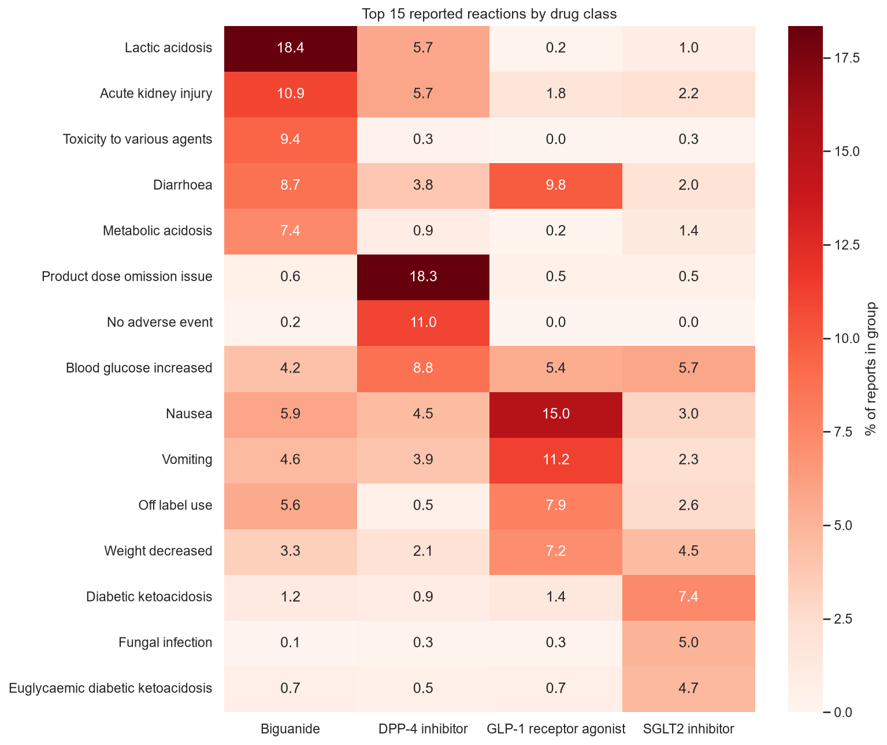
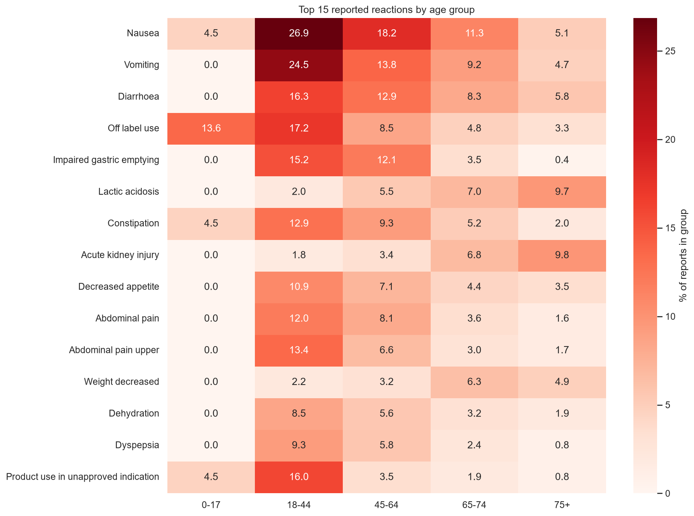
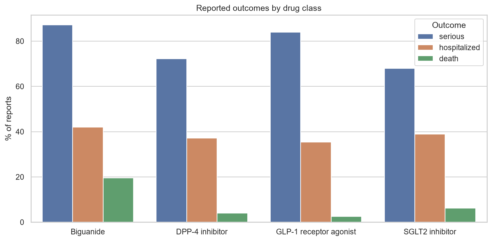
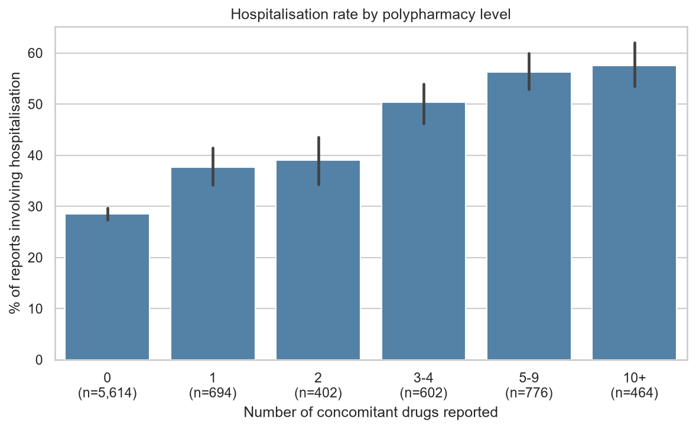
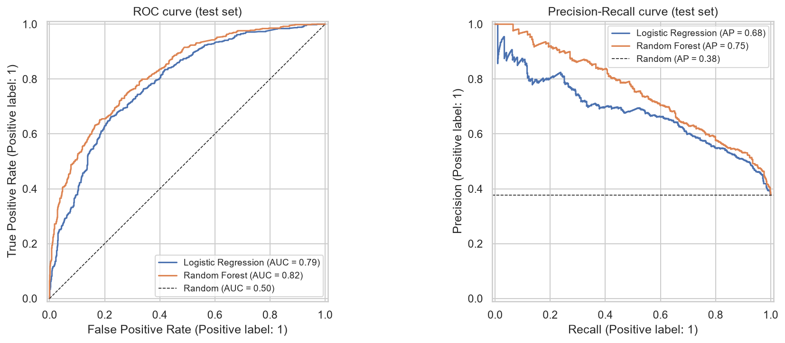
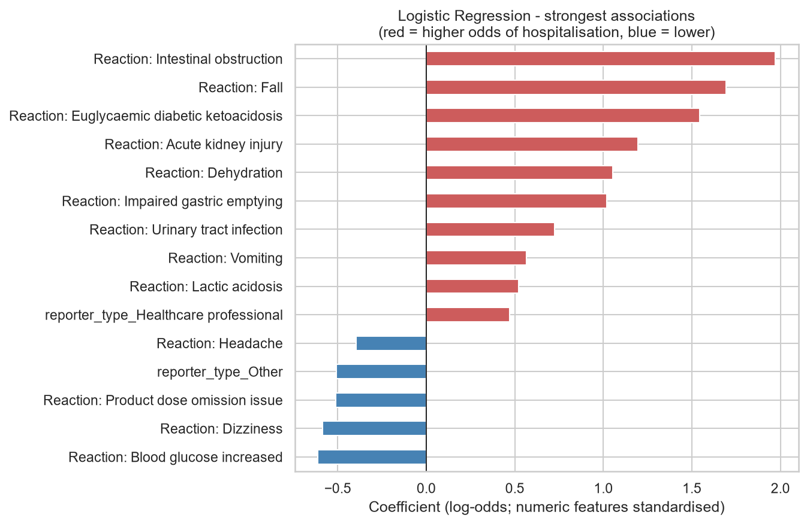
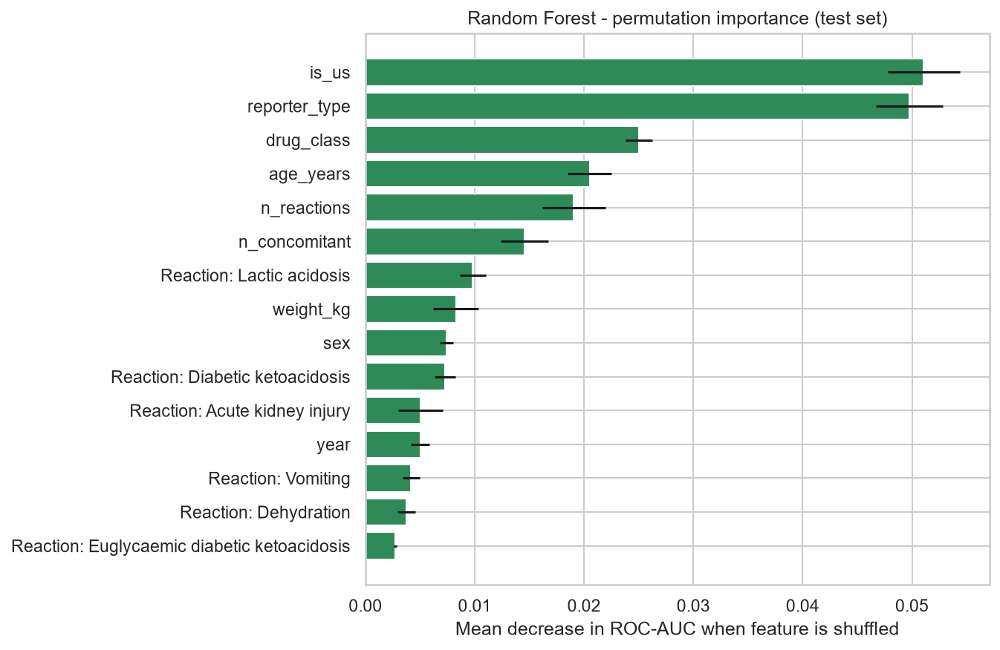
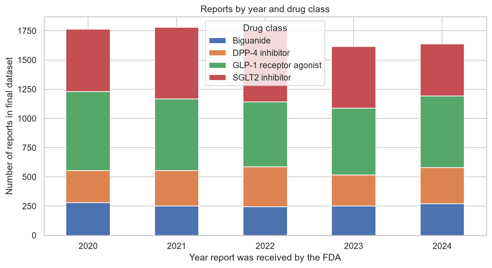
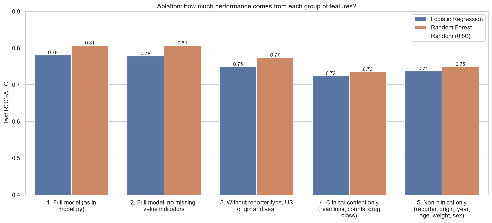

# Adverse Event Reporting for Type 2 Diabetes Medications
### An analysis of FDA Adverse Event Reporting System (FAERS) data via the openFDA API


---

## Key Findings

- **Where a report comes from matters as much as what it describes.** A report mentions
  hospitalisation in 48.5% of cases when submitted by a healthcare professional versus 20.2% for
  consumers, in 52.7% of non-US reports versus 21.0% of US reports, and in 42.5% of reports that
  record the patient's age versus 21.6% of those that do not.
- **Each drug class has a distinct reporting profile** consistent with its pharmacology:
  gastrointestinal reactions for semaglutide (nausea 15.0%, vomiting 11.2%), lactic acidosis (18.4%)
  and acute kidney injury (10.9%) for metformin, dose-omission reports for sitagliptin (18.3%), and
  diabetic ketoacidosis (7.4%) and fungal infection (5.0%) for empagliflozin.
- **Polypharmacy is associated with hospitalisation:** the rate rises from 28.5% in reports with
  no concomitant drugs to about 56–58% in reports with five or more.
- **A Random Forest predicts hospitalisation** with a test ROC-AUC of **0.81** and a PR-AUC of
  **0.72** (random baseline 0.35). An ablation study shows that report-content features and
  reporting-related features each reach about 0.74–0.75 on their own, so the model reflects
  both clinical events and how events are reported.

---

## 1. Introduction

The FDA Adverse Event Reporting System (FAERS) collects reports of suspected adverse
drug reactions submitted by healthcare professionals, consumers and manufacturers.
It is one of the main data sources used in **pharmacovigilance**, the science of
monitoring the safety of medicines after they reach the market.

This project builds an end-to-end data pipeline that:

1. **extracts** adverse event reports from the public openFDA API,
2. **cleans and transforms** deeply nested JSON into analysis-ready tables,
3. **explores** reporting patterns through visualisations,
4. **trains machine learning models** to predict whether a reported event involved
   hospitalisation, and
5. **tests the robustness** of the sampling and of the model.

The analysis focuses on four widely prescribed type 2 diabetes medications, each
representing a different drug class:

| Drug | Drug class | Example brand names |
|---|---|---|
| Metformin | Biguanide | Glucophage |
| Sitagliptin | DPP-4 inhibitor | Januvia |
| Empagliflozin | SGLT2 inhibitor | Jardiance |
| Semaglutide | GLP-1 receptor agonist | Ozempic, Rybelsus, Wegovy |

## 2. Motivation

Working as a pharmacy technician, I see every day how many patients manage type 2
diabetes with several medications at once, and how important it is to understand
their side effects. This project combines that practical perspective with my
background in statistics to explore what real-world safety reports can, and cannot,
tell us about these medicines.

## 3. Research Questions

| # | Question |
|---|---|
| **RQ1** | Which adverse reactions are most frequently reported for each drug class, and how do they differ across age groups? |
| **RQ2** | How do serious outcomes (hospitalisation, death) vary across drug classes, age groups and report sources? |
| **RQ3** | Is the number of concomitant medications (polypharmacy) or the reported dose associated with the severity of reported events? |
| **RQ4** | Can a simple machine learning model predict whether a reported adverse event involved hospitalisation, and which features drive its predictions? |

## 4. Data

**Source:** [openFDA Drug Adverse Event API](https://open.fda.gov/apis/drug/event/), a public,
harmonised version of FAERS.

**Sampling design.** For each drug, the 250 most recent reports in each of the 20 calendar
quarters between 1 January 2020 and 31 December 2024 (up to 5,000 per drug), so that every year
is represented. An earlier version took the 5,000 most recent reports per drug; a check showed
that 95% of them were from 2024, so the design was changed (see section 9.6).

**Filters:**
- Only reports where the study drug is listed as a **suspect** drug (not merely concomitant)
- Reports where more than one study drug is suspect are excluded, to keep drug classes comparable

**Key fields used:**

| Field | Description |
|---|---|
| `serious`, `seriousnesshospitalization`, `seriousnessdeath` | Outcome flags |
| `patient.patientonsetage` + unit | Age at onset (converted to years) |
| `patient.patientsex`, `patient.patientweight` | Demographics |
| `patient.drug[].drugcharacterization` | Suspect / concomitant / interacting drug |
| `patient.drug[].drugstructuredosagenumb` + unit | Structured dose (used when reported in mg) |
| `patient.reaction[].reactionmeddrapt` | Reported reactions (MedDRA Preferred Terms) |
| `primarysource.qualification` | Reporter type (healthcare professional vs consumer) |
| `occurcountry` | Country where the event occurred (US vs non-US) |

**Cleaning log:**

| Step | Reports |
|---|---|
| Downloaded (up to 250 per quarter per drug) | 20,000 |
| After removing duplicates | 20,000 |
| Study drug listed as suspect | 9,233 |
| Only one study drug suspect (final dataset) | **8,552** |

**Final dataset:** 8,552 reports and 30,565 report-reaction pairs.

| Drug | Matching reports in FAERS (2020–2024) | Reports in final dataset |
|---|---|---|
| Metformin | 138,742 | 1,297 |
| Sitagliptin | 24,069 | 1,496 |
| Empagliflozin | 40,826 | 2,732 |
| Semaglutide | 38,208 | 3,027 |

Of the 5,000 reports downloaded per drug, about 26% (metformin) and 30% (sitagliptin) ended up
in the final dataset, against 55% (empagliflozin) and 61% (semaglutide). This is consistent with
metformin's role as first-line background therapy, which is often recorded as a concomitant
medication in reports about other drugs.

## 5. Methodology

```
openFDA API ──► fetch_data.py ──► clean_data.py ──► eda.py ──► model.py ──► checks.py
  (JSON)         raw JSON         flat CSV tables    figures   models       robustness
```

**Cleaning (`clean_data.py`):** flattened nested JSON into report-level and reaction-level
tables; converted age from mixed units to years and removed implausible values; decoded coded
fields; engineered features (number of concomitant drugs, number of reactions, age groups,
polypharmacy groups); removed duplicate report IDs.

**Exploratory analysis (`eda.py`):** data completeness, outcome rates by class, most frequent
reactions by class and age group, hospitalisation by polypharmacy, age and dose (with 95%
confidence intervals), Spearman correlations.

**Machine learning (`model.py`):**
- **Target:** whether the report indicates hospitalisation (35.4% of reports)
- **Features:** age, weight, sex, reporter type, drug class, number of concomitant drugs,
  number of reactions, report year, US vs non-US, and the 30 most frequent reactions
- **Models:** Logistic Regression (interpretable baseline) and Random Forest
- **Validation:** stratified 80/20 split and 5-fold cross-validation; balanced class weights
- **Missing values:** median imputation with missing-value indicators
- **Leakage prevention:** other seriousness flags (e.g. death) and outcome-describing reaction
  terms (e.g. *Hospitalisation*) are excluded; reaction features are chosen from the training set only
- **Evaluation:** ROC-AUC, PR-AUC (compared with the prevalence baseline), precision, recall, F1
- **Interpretation:** logistic regression coefficients and Random Forest permutation importance

**Robustness checks (`checks.py`):** distribution of reports over time and an ablation study
that retrains both models on subsets of features.

## 6. Technologies Used

| Category | Tools |
|---|---|
| Language | Python 3.10+ |
| Data extraction | `requests`, openFDA REST API |
| Data wrangling | `pandas`, `numpy` |
| Visualisation | `matplotlib`, `seaborn` |
| Machine learning | `scikit-learn` (pipelines, imputation, encoding, cross-validation) |
| Development | PyCharm, Git, GitHub |

## 7. Project Structure

```
faers-diabetes-adverse-events/
├── README.md
├── requirements.txt
├── src/
│   ├── config.py           # shared settings
│   ├── fetch_data.py       # 1. data extraction (openFDA API, sampled by quarter)
│   ├── clean_data.py       # 2. cleaning and transformation
│   ├── eda.py              # 3. exploratory analysis and figures
│   ├── model.py            # 4. machine learning
│   ├── checks.py           # 5. robustness checks (time coverage, ablation)
│   └── report_numbers.py   # 6. prints the statistics quoted in this README
├── data/                   # raw and processed data (not tracked in Git)
├── figures/                # generated charts (01-14)
└── results/                # metrics and summary tables
```

## 8. How to Run

```bash
# 1. Clone the repository and install dependencies
git clone https://github.com/<your-username>/faers-diabetes-adverse-events.git
cd faers-diabetes-adverse-events
pip install -r requirements.txt

# 2. (Optional) set a free openFDA API key for higher rate limits
#    macOS / Linux:
export OPENFDA_API_KEY="your_key"
#    Windows (PowerShell):
$env:OPENFDA_API_KEY="your_key"

# 3. Run the pipeline
python src/fetch_data.py
python src/clean_data.py
python src/eda.py
python src/model.py
python src/checks.py
python src/report_numbers.py
```

Results depend on the date of download, as FAERS is updated continuously.

## 9. Results

### 9.1 Data quality

Data completeness varies considerably across fields: weight was missing in **76%** of reports,
structured dose in **55%**, age in **34%** and sex in **9%** (see
[`figures/01_missingness.png`](figures/01_missingness.png)). Structured dose coverage ranged from
34% (biguanide) to 51% (GLP-1 receptor agonist), which limits the dose analysis in RQ3.

Missingness is strongly related to the outcome. Reports that record the patient's age mention
hospitalisation far more often than reports that do not, and the same holds for weight:

| Field | Recorded: hospitalised (%) | Missing: hospitalised (%) |
|---|---|---|
| Age | 42.5 (n = 5,653) | 21.6 (n = 2,899) |
| Weight | 51.1 (n = 2,083) | 30.3 (n = 6,469) |

Complete reports tend to describe more severe, clinically documented events, whereas short
consumer reports are often incomplete and less severe (section 9.3). This overlaps with the
report-source effects described below, and I did not separate them.

### 9.2 Reported reactions (RQ1)



The heatmap shows the 15 most frequent reactions overall. The five most frequent reactions
within each class give a clearer picture of class-specific profiles:

| Drug class | Top 5 reactions (% of reports in class) |
|---|---|
| **Biguanide** | Lactic acidosis 18.4 · Acute kidney injury 10.9 · Toxicity to various agents 9.4 · Diarrhoea 8.7 · Metabolic acidosis 7.4 |
| **DPP-4 inhibitor** | Product dose omission issue 18.3 · No adverse event 11.0 · Blood glucose increased 8.8 · Acute kidney injury 5.7 · Lactic acidosis 5.7 |
| **GLP-1 receptor agonist** | Nausea 15.0 · Vomiting 11.2 · Diarrhoea 9.8 · Off label use 7.9 · Weight decreased 7.2 |
| **SGLT2 inhibitor** | Diabetic ketoacidosis 7.4 · Blood glucose increased 5.7 · Fungal infection 5.0 · Euglycaemic diabetic ketoacidosis 4.7 · Weight decreased 4.5 |

Each class shows a profile consistent with its known pharmacology:

- **Semaglutide (GLP-1):** gastrointestinal reactions dominate (nausea, vomiting, diarrhoea,
  constipation 6.1%, decreased appetite 6.7%). *Off label use* (7.9%) and *weight decreased*
  (7.2%) suggest part of the use is for weight management.
- **Metformin (biguanide):** lactic acidosis, acute kidney injury and metabolic acidosis, the
  best-known serious safety concerns for metformin, together with *toxicity to various agents*
  (overdose or exposure reports).
- **Sitagliptin (DPP-4):** the profile is dominated by *product dose omission issue* and
  *no adverse event*, pointing to adherence and administrative reports, not drug toxicity.
- **Empagliflozin (SGLT2):** diabetic ketoacidosis (including the euglycaemic form), the best-known
  serious SGLT2 inhibitor risk, and fungal infection, a known genital mycotic effect.

Several frequent terms are non-clinical (*product dose omission issue*, *no adverse event*,
*off label use*) and describe how a medicine was used or reported, not a physiological reaction.



The reaction profile also changes with age (the 0–17 group has only 37 reports and is not interpreted):

| Reaction | 18–44 | 45–64 | 65–74 | 75+ |
|---|---|---|---|---|
| Nausea | 15.0 | 11.6 | 8.8 | 5.5 |
| Vomiting | 12.8 | 8.9 | 5.6 | 4.4 |
| Off label use | 12.8 | 5.0 | 4.0 | 2.7 |
| Diabetic ketoacidosis | 5.0 | 4.1 | 2.8 | 1.6 |
| Lactic acidosis | 2.1 | 4.6 | 6.5 | 7.5 |
| Acute kidney injury | 0.5 | 3.9 | 7.1 | 7.0 |

Gastrointestinal and off-label reports decline with age, whereas lactic acidosis and acute
kidney injury rise, in line with the age-related decline in kidney function, a known risk factor
for metformin-associated lactic acidosis. These patterns partly reflect who uses each drug
(for example, semaglutide patients are younger) and were not adjusted for drug class.

### 9.3 Serious outcomes (RQ2)



| Drug class | Reports | Serious (%) | Hospitalised (%) | Death (%) | Median age | Female (%) | Reported by HCP (%) |
|---|---|---|---|---|---|---|---|
| Biguanide | 1,297 | 91.6 | 49.0 | 18.9 | 65 | 45.2 | 76.7 |
| DPP-4 inhibitor | 1,496 | 68.9 | 35.2 | 5.1 | 70 | 45.3 | 62.4 |
| GLP-1 receptor agonist | 3,027 | 86.5 | 34.1 | 3.2 | 62 | 58.6 | 42.6 |
| SGLT2 inhibitor | 2,732 | 59.3 | 30.5 | 5.1 | 67 | 42.2 | 48.3 |

The overall hospitalisation rate is 35.4%.

- **Metformin** reports have the highest proportion of serious outcomes (91.6%), hospitalisations
  (49.0%) and deaths (18.9%), and 77% were submitted by healthcare professionals. Because metformin
  is usually background therapy, it is likely recorded as the *suspect* drug mainly in severe
  clinical cases such as lactic acidosis. This is a selection effect, not evidence that metformin
  is the most dangerous drug in the group.
- **GLP-1 receptor agonist** reports come from the youngest patients (median 62), are the most
  often female (58.6%), and have the lowest share of healthcare-professional reporters (42.6%)
  and the lowest death rate (3.2%).
- **SGLT2 inhibitor** reports have the lowest proportion of serious outcomes (59.3%) and of
  hospitalisations (30.5%).

**Age.** There is no meaningful age gradient overall: the hospitalisation rate is 43.5% at 18–44,
42.3% at 45–64, 40.4% at 65–74 and 44.9% at 75+ (95% CI about ±2–4 points). By class, rates in
adult age groups were:

| Drug class | 18–44 | 45–64 | 65–74 | 75+ |
|---|---|---|---|---|
| Biguanide | 45.0 (n=129) | 50.6 (n=346) | 53.1 (n=290) | 62.1 (n=253) |
| DPP-4 inhibitor | 40.0 (n=40) | 43.0 (n=291) | 53.2 (n=299) | 44.6 (n=359) |
| GLP-1 receptor agonist | 41.4 (n=280) | 38.5 (n=850) | 34.5 (n=571) | 46.6 (n=253) |
| SGLT2 inhibitor | 48.2 (n=112) | 42.6 (n=570) | 33.0 (n=560) | 33.7 (n=413) |

Metformin has the highest rate in the oldest group (62.1%), whereas SGLT2 inhibitor rates are
lower after 65. With about 250–850 reports per cell (95% CI roughly ±4–9 points), only the larger
differences should be interpreted.

**Report source.** The strongest differences in hospitalisation rate were not clinical:

| Report characteristic | Hospitalised (%) | n |
|---|---|---|
| Reporter: healthcare professional | 48.5 | 4,538 |
| Reporter: consumer | 20.2 | 3,944 |
| Event country: outside the US | 52.7 | 3,877 |
| Event country: US | 21.0 | 4,675 |

Reports from healthcare professionals and from outside the US mention hospitalisation more than
twice as often as consumer and US reports. A plausible explanation, not tested here, is that
serious cases are subject to mandatory expedited reporting by manufacturers and regulators,
whereas US reports include many voluntary consumer reports of milder events. These two
characteristics also overlap, which I did not disentangle.

### 9.4 Polypharmacy and dose (RQ3)



| Concomitant drugs | Reports | Hospitalised (%) | 95% CI |
|---|---|---|---|
| 0 | 5,614 | 28.5 | ±1.2 |
| 1 | 694 | 37.6 | ±3.6 |
| 2 | 402 | 39.1 | ±4.8 |
| 3–4 | 602 | 50.3 | ±4.0 |
| 5–9 | 776 | 56.3 | ±3.5 |
| 10+ | 464 | 57.5 | ±4.5 |

The hospitalisation rate roughly doubles, from 28.5% with no concomitant drugs to about 56–58%
with five or more, with a plateau from five drugs onwards (the intervals for 5–9 and 10+ overlap).
In the Spearman correlation matrix ([`figures/08_correlations.png`](figures/08_correlations.png)),
hospitalisation is correlated with the total number of drugs (ρ = 0.23), the number of
concomitant drugs (ρ = 0.22) and the number of reported reactions (ρ = 0.15), but not with age
(ρ = 0.00) or weight (ρ = −0.04). Hospitalisation and death are almost uncorrelated (ρ = −0.02),
since fatal cases are often not additionally flagged as hospitalisations.

These associations should be interpreted with care. Patients taking many medications probably
have more comorbidities, and reports from healthcare professionals, which are more often
hospital-related, document medication lists more completely. Polypharmacy may therefore be a
marker of patient complexity and report quality rather than a direct cause of hospitalisation.
I did not stratify by reporter type.

**Dose.** Structured dose (in mg, per administration) was available for 34–51% of reports
([`figures/07_dose_vs_hospitalization.png`](figures/07_dose_vs_hospitalization.png)):

| Drug class | Not hospitalised: median (IQR), n | Hospitalised: median (IQR), n |
|---|---|---|
| Biguanide | 500 (500–1000), 190 | 850 (500–1000), 253 |
| DPP-4 inhibitor | 100 (50–100), 363 | 100 (50–100), 306 |
| GLP-1 receptor agonist | 0.5 (0.25–1.0), 958 | 0.5 (0.25–1.0), 579 |
| SGLT2 inhibitor | 10 (10–25), 764 | 10 (10–25), 456 |

Doses were essentially identical between hospitalised and non-hospitalised reports. The only
difference is a higher median metformin dose in hospitalised reports (850 vs 500 mg), with the
same interquartile range. An apparent lower semaglutide dose in hospitalised reports observed in an
earlier, narrower sample did not replicate. Because doses are recorded per administration on
different scales and formulations (semaglutide includes weekly injectable and daily oral
products), the dose analysis is exploratory and supports no firm conclusion.

_Additional figures: [`06_hospitalization_by_age_and_class.png`](figures/06_hospitalization_by_age_and_class.png)
and [`10_confusion_matrices.png`](figures/10_confusion_matrices.png)._

### 9.5 Predicting hospitalisation (RQ4)

| Model | CV ROC-AUC | Test ROC-AUC | Test PR-AUC | Precision | Recall | F1 |
|---|---|---|---|---|---|---|
| Logistic Regression | 0.784 ± 0.013 | 0.781 | 0.639 | 0.573 | 0.727 | 0.641 |
| Random Forest | 0.800 ± 0.018 | **0.807** | **0.719** | **0.584** | **0.734** | **0.651** |
| *Random baseline* | 0.50 | 0.50 | 0.354 | – | – | – |



- The **Random Forest performed best**, with a test ROC-AUC of 0.81 and a PR-AUC of 0.72, about
  twice the random baseline of 0.35 (the hospitalisation prevalence).
- Its advantage over logistic regression is modest in ROC-AUC (0.026, comparable to the
  fold-to-fold standard deviation of 0.013–0.018) and clearer in PR-AUC (0.719 vs 0.639).
- Cross-validation and test scores are close for both models, indicating stable performance.
- On the test set (1,711 reports, 605 with hospitalisation, threshold 0.5), the Random Forest
  identified 444 hospitalisations (recall 73%) with 316 false positives (precision 58%); logistic
  regression identified 440 with 328 false positives
  ([`figures/10_confusion_matrices.png`](figures/10_confusion_matrices.png)).



The logistic regression coefficients (log-odds; numeric features standardised) are
**clinically coherent**. Reactions most strongly associated with hospitalisation were *diabetic
ketoacidosis* (1.54, odds ratio about 4.7), *dehydration* (1.49), *euglycaemic diabetic
ketoacidosis* (1.41), *acute kidney injury* (1.10), *lactic acidosis* (1.09), *fall* (0.94),
*vomiting* (0.70) and *urinary tract infection* (0.51). Terms associated with lower odds included
*no adverse event* (−2.14), *fungal infection* (−1.45), *dizziness* (−0.53), *drug ineffective*
(−0.50), *weight decreased* and *blood glucose increased* (both −0.46): milder events or
administrative reports.



In the Random Forest, permutation importance (mean decrease in test ROC-AUC) was highest for
the two report-source variables, **US vs non-US origin (0.051)** and **reporter type (0.050)**,
consistent with the large descriptive differences in section 9.3. They were followed by drug class
(0.025), age (0.021), number of reactions (0.019) and number of concomitant drugs (0.015). Among
individual reactions, lactic acidosis (0.010), diabetic ketoacidosis (0.007) and acute kidney
injury (0.005) contributed most. Age has almost no linear correlation with hospitalisation, so its
importance probably reflects the fact that a missing age marks less severe reports (section 9.1)
and non-linear effects. Permutation importance can overstate the contribution of correlated
features, which the ablation study below tests.

### 9.6 Robustness checks



**Time coverage.** An earlier version of this analysis downloaded the 5,000 most recent reports
per drug. A check showed that 95% of them were from 2024 and that the time window ranged from
75 to 488 days depending on the drug, so the sampling was changed to 250 reports per quarter.
In the final dataset every drug class spans about 1,750 days, and each year contributes 19–21%
of reports. This even distribution results from the design, so trends in reporting volume cannot
be analysed. In the earlier sample the Random Forest reached a test ROC-AUC of 0.82, versus 0.81 here.

| Year | Reports | Hospitalised (%) |
|---|---|---|
| 2020 | 1,765 | 34.3 |
| 2021 | 1,781 | 34.8 |
| 2022 | 1,752 | 35.5 |
| 2023 | 1,616 | 34.2 |
| 2024 | 1,638 | 38.3 |

The modest increase in 2024 may partly reflect the changing mix of drug classes (empagliflozin
has the lowest hospitalisation rate and the fewest reports in 2024); I did not test this.



**Ablation study.** To test how much of the model's performance comes from report content versus
reporting characteristics, both models were retrained on feature subsets using the same split.

| Feature set | Random Forest (test ROC-AUC) | Logistic Regression (test ROC-AUC) |
|---|---|---|
| Full model | 0.807 | 0.781 |
| Without missing-value indicators | 0.807 | 0.778 |
| Without reporter type, US origin and year | 0.774 | 0.749 |
| Content only (reactions, counts, drug class) | 0.735 | 0.724 |
| Reporting/demographic only (reporter, origin, year, age, weight, sex) | 0.749 | 0.737 |

- Report-content features and reporting/demographic features each reach a ROC-AUC of about
  0.74–0.75 on their own (random = 0.50), and combining them gives 0.81. The model therefore
  captures both *what* was reported and *how* it was reported, and the two groups of features overlap partly.
- Removing reporter type, US origin and year costs about 0.03 AUC, even though they top the
  permutation importance ranking, because other features carry overlapping information.
- Removing the missing-value indicators changed almost nothing (Random Forest 0.807 to 0.807,
  logistic regression 0.781 to 0.778). This does **not** mean missingness is uninformative:
  section 9.1 shows that reports without an age have half the hospitalisation rate. It means the
  indicators add little beyond reporter type, origin and the other features, which overlap with
  them. For the Random Forest the test is also not clean, because median-imputed values remain
  identifiable to tree splits.
- The labels are approximate: the number of reactions and of concomitant drugs also reflect how
  complete a report is, and age and weight are clinical variables as well as reporting ones.
- With 1,711 test reports, differences below about 0.02 AUC should not be over-interpreted,
  including the gap between the two subsets.

## 10. Conclusions

- **RQ1:** Each drug class has a distinct reporting profile that matches its known pharmacology:
  gastrointestinal reactions for semaglutide, lactic acidosis and acute kidney injury for
  metformin, dose-omission reports for sitagliptin, and diabetic ketoacidosis and fungal
  infection for empagliflozin. Gastrointestinal and off-label reports decrease with age, whereas
  lactic acidosis and acute kidney injury increase.
- **RQ2:** Metformin reports had the highest rates of serious outcomes, hospitalisation and
  death, most likely reflecting a selection effect toward severe cases. Hospitalisation varied
  little with age, but strongly with report source: 48.5% for healthcare professionals versus
  20.2% for consumers, and 52.7% outside the US versus 21.0% in the US.
- **RQ3:** Polypharmacy was associated with hospitalisation (28.5% with no concomitant drugs
  versus 56–58% with five or more), probably reflecting patient complexity and report quality.
  Dose showed no meaningful association.
- **RQ4:** A Random Forest predicted hospitalisation with a test ROC-AUC of 0.81 and a PR-AUC
  of 0.72 (versus a 0.35 baseline). The ablation study showed that report-content features and
  reporting-related features each carry substantial signal, so the model reflects both clinical
  events and how events are reported.

## 11. Limitations

FAERS data must be interpreted with care. The main limitations are:

- **No denominator.** FAERS does not record how many patients took a drug without problems,
  so reporting *frequencies* cannot be interpreted as *incidence rates* or risks.
- **Causality is not established.** A report means a reaction was *suspected*, not proven.
- **The outcome partly reflects reporting.** Hospitalisation rates differ by a factor of 2–2.5
  between report sources, so the outcome flag measures how events are reported as well as what
  happened. The model predicts whether a *report* mentions hospitalisation, not a patient's
  clinical risk, and its findings describe associations within reported data only.
- **Reporting bias.** Under-reporting is common, and reporting can be stimulated by media
  attention or regulatory news (for example, public interest in GLP-1 medications in 2022–2024).
- **Mixed indications.** Semaglutide is used for type 2 diabetes and for weight management, so its
  reports cover different populations.
- **Missing data.** Weight (76%), dose (55%) and age (34%) are frequently missing, and
  missingness is related to the outcome. Median imputation is simple and may distort distributions.
- **Non-clinical MedDRA terms.** Several frequent terms (*off label use*, *product dose omission
  issue*, *no adverse event*) describe medication use or reporting, not physiological reactions.
- **Sampling.** The 250 most recent reports in each quarter were used per drug. Allocation is
  equal across quarters regardless of volume and not random, so findings describe this sample
  and trends in reporting volume cannot be studied.
- **Possible duplicates.** Only duplicate report IDs were removed; the same case may be
  submitted under several IDs, which could make test scores slightly optimistic.
- **Unadjusted comparisons.** Differences between classes, ages and report sources are
  descriptive. They were not adjusted for confounders and no formal hypothesis tests were run.
- **Combination products.** Reports with more than one suspect study drug (for example
  metformin–sitagliptin fixed-dose products) were excluded.
- **Modelling choices.** Hyperparameters were not tuned, probability calibration was not
  assessed, and a random (not time-based) split was used.

## 12. Future Work

- **Disproportionality analysis** (Proportional Reporting Ratio, Reporting Odds Ratio), the
  standard pharmacovigilance method for detecting safety signals
- Stratifying the polypharmacy and class comparisons by reporter type and origin
- Case-level de-duplication and handling of fixed-dose combination products
- Filtering semaglutide reports by indication (diabetes vs weight management)
- Separating clinical reactions from medication-use issues in the MedDRA terms
- Gradient boosting with SHAP explanations, calibration and a time-based split
- An interactive dashboard (e.g. Streamlit) for exploring reactions by drug
- An equivalent implementation in R / tidyverse or SAS

## 13. Disclaimer

This project is for educational and portfolio purposes only and does not constitute
medical advice. As stated by openFDA, its data should not be relied upon to make
decisions regarding medical care. Patients should always consult a healthcare
professional about their medications.

## 14. Author

**[Your Name]**
BSc Statistics, minor in Computer Science, Wayne State University
[LinkedIn](https://www.linkedin.com/in/your-profile) · [Email](mailto:your.email@example.com)